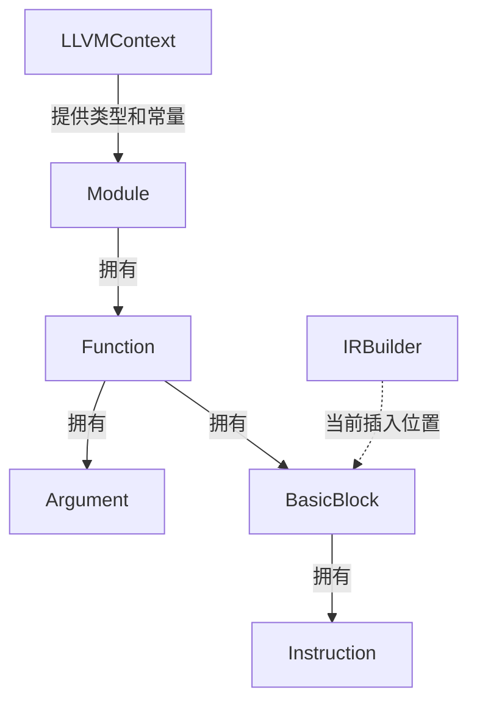

# D4 · Kaleidoscope 从 AST 生成 LLVM IR

对应 LLVM 教程第 3 章，使用 LLVM 23.1.5。示例命令从仓库根目录运行，假设 `./build/toy` 已构建，`opt`、`llc` 来自同一套 LLVM。本文按 D4 四次提交后的实现记录，修复前的行为单独标明。

## 1. 当天目标与四次提交

D3 已能把源码解析成 AST。D4 要让 AST 构造一个 LLVM 模块，并用两种方法验收：人能对着源码解释每条 IR，LLVM 工具能直接读取和验证输出。

| 提交 | 改动集中在哪里 | 用什么现象验证 |
|---|---|---|
| 1 · 为表达式和函数生成 IR | AST 的 `codegen()`、模块初始化、驱动和 CMake 的 `core support` 组件 | 输入函数定义，得到带 `entry` 和 `ret` 的 `define` |
| 2 · 增加 `-emit-llvm` | 三个顶层 handler 和 `main()` | 一份输入生成一个模块，stdout 可直接接入 `opt` |
| 3 · 打印 verifier 诊断，增加 `dumpValue` | `FunctionAST::codegen()` 和调试辅助函数 | 缺少终结指令时能指出具体基本块，在 GDB 中能查看 `Value *` 的 IR |
| 4 · 修复已有声明的形参绑定 | `ProtoTypeAST::getArgs()`、函数体生成之前的参数检查和命名 | 声明、定义使用不同形参名时能生成正确 IR，参数个数冲突时有明确诊断 |

## 2. 用一个函数看清后序遍历与 SSA

```bash
printf 'def foo(a b) a*a + 2*a*b + b*b;\n' | ./build/toy -parse-only -dump-ast
printf 'def foo(a b) a*a + 2*a*b + b*b;\n' | ./build/toy -emit-llvm
```

乘法的优先级高于加法，同优先级的这些运算符左结合。函数体的分组是 `((a*a) + ((2*a)*b)) + (b*b)`。根节点是最后一个加号。在 `BinaryExprAST::codegen()` 中，先调用 `LHS->codegen()`，再调用 `RHS->codegen()`，最后才有两个操作数可供当前节点使用。这就是指令呈后序排列的原因。

下面是实际输出中的函数体。

```llvm
define double @foo(double %a, double %b) {
entry:
  %multmp = fmul double %a, %a
  %multmp1 = fmul double 2.000000e+00, %a
  %multmp2 = fmul double %multmp1, %b
  %addtmp = fadd double %multmp, %multmp2
  %multmp3 = fmul double %b, %b
  %addtmp4 = fadd double %addtmp, %multmp3
  ret double %addtmp4
}
```

| 源码或 AST 节点 | 产生的 IR | 这个值去了哪里 |
|---|---|---|
| 左子树 `a*a` | `%multmp = fmul ...` | 内层加法的左操作数 |
| `2*a` | `%multmp1 = fmul ...` | 下一次乘法的左操作数 |
| `(2*a)*b` | `%multmp2 = fmul ...` | 内层加法的右操作数 |
| `a*a + (2*a)*b` | `%addtmp = fadd ...` | 根节点的左操作数 |
| 右子树 `b*b` | `%multmp3 = fmul ...` | 根节点的右操作数 |
| 根节点的加法 | `%addtmp4 = fadd ...` | 函数体返回给 `FunctionAST` 的 `Value *` |
| 函数定义收尾 | `ret double %addtmp4` | 结束 `entry` 块，向调用方返回函数体的值 |

这里可以数出四条乘法、两条加法和一条返回。AST 中还出现了变量和字面量，但读取 `a` 只需查到已有的 `Argument`，读取 `2` 只需取得 `ConstantFP`。两者都可以直接作为操作数。

**SSA 在代码里是什么样子？** 以 `%multmp1` 为例，生成第一条相关乘法时得到一个 `Value *`，生成下一条乘法时把同一个指针作为操作数传进去。打印器把这条定义和后续对它的使用都写成 `%multmp1`。后缀由 LLVM 消除重名时分配；要解释程序，重点是沿着操作数找到定义。

## 3. 对象归属、类型层次与插入点



`TheContext` 和 `TheModule` 在本项目里各由一个 `unique_ptr` 管理。创建模块时传入 `*TheContext`，模块使用该上下文，生命周期上要求上下文活得更久。图中从 Context 到 Module 的边表示这种依赖。函数则通过 `Function::Create(..., TheModule.get())` 直接加入模块。即使随后销毁解析得到的 AST，已经加入模块的具名函数仍然存在。

**归属回答“谁管理对象的生命周期”，继承回答“这个对象能当什么用”。** D4 用得最多的继承路径如下：

| 对象 | 与 `Value` 的关系 | 本项目实例 |
|---|---|---|
| `Argument` | 继承 `Value` | `%a` 可以直接传给浮点乘法 |
| `ConstantFP` | 经 `Constant`、`User` 继承 `Value` | `2.0` 可以直接做操作数 |
| `Instruction` | 经 `User` 继承 `Value` | `fmul` 有操作数，其结果又可被 `fadd` 使用 |
| `Function` | 经 `GlobalObject`、`GlobalValue`、`Constant` 等继承 `Value` | `@cos` 可以作为调用目标 |
| `BasicBlock` | 继承 `Value` | `entry` 容纳一串有序指令，以终结指令收尾 |

`ret` 也是指令，但类型是 `void`，没有可供下一条算术指令使用的结果。看到 `Value *` 时，要结合具体对象和 IR 类型判断它代表参数、常量还是计算结果。

## 4. 对着 toy.cpp 走一遍

### 从函数签名走到函数体

1. `InitializeModule()` 建立上下文、模块和 builder。启动一次 `toy` 处理整份输入时，各个顶层定义共享这个模块。
2. `ProtoTypeAST::codegen()` 根据参数个数构造 `FunctionType`。当前参数和返回值都是 `double`。调用 `Function::Create` 时使用 `ExternalLinkage`，符号可以在模块外被引用。只有签名时，打印为 `declare`；有函数体时，打印为 `define`。单独一句 `extern cos(x);` 不要求此时就能执行外部的 `cos`。
3. `FunctionAST::codegen()` 先按名查找已有函数，必要时创建；检查重定义和参数个数，按本次定义绑定形参。随后创建 `entry`，用 `SetInsertPoint(BB)` 指定接下来的指令写到哪里。
4. `NamedValues.clear()` 后，将当前函数的形参名映射到各自的 `Argument *`。`NamedValues` 是可重复使用的全局容器，里面的名字绑定只服务于当前正在生成的函数。清空映射不会销毁函数拥有的参数。
5. `Body->codegen()` 递归返回函数体的结果。`CreateRet(RetVal)` 完成基本块，`verifyFunction(*TheFunction, &errs())` 检查结构。函数体生成失败时，当前实现会调用 `eraseFromParent()` 清理正在构造的函数。复用已有声明后走这条失败路径，也可能把原声明一起删除。

### 常用 API 速查

| 源码动作 | API | 结果或约束 |
|---|---|---|
| 数字字面量 | `ConstantFP::get(*TheContext, APFloat(Val))` | 得到浮点常量 |
| 切换基本块 | `Builder->SetInsertPoint(BB)` | 后续需要创建的指令插入这个块 |
| 加、减、乘 | `CreateFAdd`、`CreateFSub`、`CreateFMul` | 本语言操作数为 `double`；操作数全为常量时可能直接折叠 |
| 小于 | `CreateFCmpULT(L, R, "cmptmp")` | 返回 `i1`；无序或小于时为真，无序包括任一操作数为 NaN |
| 把布尔值作为表达式返回 | `CreateUIToFP(..., Type::getDoubleTy(*TheContext), ...)` | 将 `i1` 按无符号值转换，得到 `0.0` 或 `1.0` |
| 函数调用 | `CreateCall(CalleeF, ArgsV, "calltmp")` | 前端先查目标函数、检查实参数量，并递归生成各实参 |
| 返回 | `CreateRet(RetVal)` | 生成终结指令，返回类型须与函数签名一致 |

例如 `def lt(x y) x < y;` 的核心是两条指令：

```llvm
%cmptmp = fcmp ult double %x, %y
%booltmp = uitofp i1 %cmptmp to double
```

这里的 `ult` 属于 **浮点** 比较谓词，`u` 表示 unordered。随后用无符号转换是因为单比特值 `1` 应转成 `1.0`；把同一比特当作有符号 `i1` 会得到 `-1` 的含义。

## 5. 同一份源码，三种驱动行为

| 模式 | 何时生成 IR | 从哪里读结果 |
|---|---|---|
| 默认交互模式 | 每读完一个顶层项就生成 | 逐项 IR 和提示信息走 stderr。裸表达式包装成 `@__anon_expr`，打印后删除 |
| `-parse-only -dump-ast` | 解析后提前返回 | AST 和解析消息走 stderr，适合检查优先级和结合性 |
| `-emit-llvm` | 逐项生成，EOF 后一次打印模块 | `TheModule->print(outs(), nullptr)` 写 stdout；诊断仍走 stderr。临时匿名函数在最终打印前已删除 |

```bash
printf '4+5;\n' | ./build/toy
printf 'def nine() 4+5;\n' | ./build/toy -emit-llvm
```

两次都能看到 `ret double 9.000000e+00`：默认 `IRBuilder<>` 在创建浮点加法时发现两边都是常量，直接返回常量结果。第一条打印的是随后会删除的匿名函数；第二条输出的模块保留具名函数 `@nine`。D4 尚未运行函数优化管线，也尚未用 JIT 调用这些函数。

把 `toy` 作为其他 LLVM 工具的输入：

```bash
mkdir -p scratch
printf 'def foo(a b) a*a + 2*a*b + b*b;\n' |
  ./build/toy -emit-llvm > scratch/foo.ll
opt -passes=verify -disable-output scratch/foo.ll
opt -passes='print<domtree>' -disable-output scratch/foo.ll
llc -mtriple=x86_64-unknown-linux-gnu scratch/foo.ll -o -
```

验证成功时第一条 `opt` 安静退出。第二条的结果包含 `Roots: %entry`，因为该函数只有一个基本块。`llc` 输出目标汇编，便于比较 IR 和机器指令之间的关系；汇编细节由 LLVM 后端和目标配置决定。

## 6. 三种排错手段

### 6.1 verifier 给出哪一个块不合法

临时注释掉 `Builder->CreateRet(RetVal);`，保留 `verifyFunction(*TheFunction, &errs());`。重新构建后运行：

```bash
ninja -C build
printf 'def foo(a) a+1;\n' | ./build/toy -emit-llvm > scratch/broken.ll
```

实测 stderr：

```text
Basic Block in function 'foo' does not have terminator!
label %entry
```

对照文件，`entry` 在 `fadd` 后直接遇到了右花括号。合法 IR 要求每个基本块以终结指令结束。`verifyFunction` 对损坏的函数返回 `true`，成功返回 `false`。D4 只接通了诊断流，调用方还没有处理这个布尔值，所以这次故障实验中 `toy` 仍输出了模块，进程退出码仍为 0。恢复 `CreateRet` 并重编后再做下一项。

### 6.2 断言定位哪一次 LLVM API 调用违反了前提

手册实验是在 `+` 分支临时给 `CreateFAdd` 传入 `L` 和 `Builder->getInt32(1)`，输入 `def f(x) x+1;`。左边是 `double`，右边是 `i32`。用启用了断言的 LLVM 构建运行，在 GDB 中执行 `bt`，从断言帧向调用方寻找第一个 `src/toy.cpp` 帧。断言文本和帧号取决于构建方式。

一个单独实测的类型错误也能练习同一套读栈方法。在调试构建的 `+` 分支临时调用 `(void)cast<ConstantFP>(L);`，输入 `def add(a b) a+b;`。下面摘取的是这个强制转换实验的输出：

```text
Assertion `isa<To>(Val) && "cast<Ty>() argument of incompatible type!"' failed.
…
7  toy  …  decltype(auto) llvm::cast<llvm::ConstantFP, llvm::Value>(llvm::Value*) + 68
```

`L` 的 IR 类型确实是 `double`，其 C++ 对象却是函数参数 `Argument`。浮点参数和浮点常量可以参加相同的加法，只有后者可以转换为 `ConstantFP`。实验结束后恢复原来的 `CreateFAdd(L, R, "addtmp")`。

### 6.3 在 GDB 里检查生成到一半的值

```cpp
LLVM_DUMP_METHOD void dumpValue(const Value *V) {
  V->print(errs());
  errs() << '\n';
}
```

`LLVM_DUMP_METHOD` 定义于 `llvm/Support/Compiler.h`，用于声明调试器可调用的打印辅助函数。构建 `toy` 时保留调试信息。先准备输入，再启动 GDB：

```bash
printf 'def add(a b) a+b;\n' > /tmp/d4-add.ks
gdb ./build/toy
```

```gdb
break BinaryExprAST::codegen
run < /tmp/d4-add.ks
```

用 `next` 走到 `switch (Op)`，确认左右子树的 `codegen()` 都已返回，再执行 `p Op`、`call dumpValue(L)`、`call dumpValue(R)` 和 `bt`。这时 `Op` 是 `'+'`，下面是用同一输入实际调用该辅助函数得到的两行：

```text
double %a
double %b
```

如果输入改为 `def f(a b) a*a + b;`，加法左边会是前一步生成的乘法指令。由此可以检查“左边引用了哪条定义”，即使最终模块还没有打印出来。

## 7. 修复记录：声明与定义的形参名不一致

```bash
printf 'extern foo(a);\ndef foo(b) b;\n' | ./build/toy -emit-llvm
```

修复前出现 `Error: Unknown variable name`。C 中的对应写法是先声明 `double foo(double a);`，随后定义 `double foo(double b) { return b; }`。参数位置和类型匹配，函数体引用本次定义中的名字是合法的。

**根因。** 处理 `extern` 时，第一个 LLVM 参数被命名为 `a`。处理 `def` 时复用了模块中已有的 `Function`。前端用 `Arg.getName()` 填充符号表，只登记了 `"a"`；函数体的 `VariableExprAST("b")` 查表失败。错误发生在构造函数体期间，早于 verifier 检查。

**修复。** 在本项目的 `ProtoTypeAST` 上提供只读访问器。在 `FunctionAST::codegen()` 的重定义检查之后、创建基本块之前加入以下逻辑：

```cpp
// ProtoTypeAST 的 public 区域
const std::vector<std::string> &getArgs() const { return Args; }
```

```cpp
const auto &Params = Proto->getArgs();
if (TheFunction->arg_size() != Params.size()) {
  LogError("Definition conflicts with a declaration.");
  return nullptr;
}

for (auto &Arg : TheFunction->args())
  Arg.setName("");
for (auto &Arg : TheFunction->args())
  Arg.setName(Params[Arg.getArgNo()]);
```

先清空全部旧名，再按位置分配新名。这样处理 `extern f(a b); def f(b a) b-a;` 时，旧的第二个参数会先释放名字 `b`。如果依次直接改名，LLVM 为避免临时重名会给第一个参数分配带后缀的新名字，随后用原名 `b` 查表仍可能失败。

| 回归场景 | 应检查的结果 |
|---|---|
| `extern renamed(a); def renamed(b) b;` | 生成 `define double @renamed(double %b)`，函数体为 `ret double %b` |
| `extern swapnames(a b); def swapnames(b a) b-a;` | 生成 `fsub double %b, %a`。减法能检验两个参数的位置 |
| `extern arity(a); def arity(a b) a+b;` | 报 `Definition conflicts with a declaration.`，模块中仍有原来的一参数声明 |
| 已有函数体后再次定义 | 仍报 `Function cannot be redefined.` |
| 调用时实参数量错误 | 由 `CallExprAST::codegen()` 报 `Incorrect # arguments passed`，与定义冲突是两条不同路径 |

## 8. 回归测试与验收

`test/codegen/functions.ks` 检查正常函数、比较、调用、常量折叠和参数重命名。`errors.ks` 检查诊断。`emit-llvm.ks` 检查模块包含哪些声明与定义，并让 LLVM 读取最终输出。

```text
# RUN: %toy < %s 2>&1 | FileCheck %s
# RUN: %toy -emit-llvm < %s | FileCheck %s
# RUN: %toy -emit-llvm < %s | opt -passes=verify -disable-output
```

上面是两种模式的典型写法。第一行对应默认回显测试，后两行对应批处理测试。lit 将 `%s` 替换为当前测试文件路径。`< %s` 把文件接到 stdin，供 `getchar()` 读取；右侧 `FileCheck %s` 打开同一文件读取检查规则。默认模式用 `2>&1` 把 stderr 的回显并入管道。批处理模式的 stdout 就是 IR，诊断应保留在 stderr。

`FileCheck` 能发现符号或指令丢失，verifier 能发现模块结构或类型错误。合法空模块也可能通过验证，因此两条测试需要一起保留。第四次提交建议在已有测试文件末尾追加用例，并使用新函数名，以免先触发重定义错误。

```bash
ninja -C build check
scripts/diff-ref.sh 3
```

复盘时应能独立完成三件事：

- 遮住 IR，根据 `foo` 的 AST 写出四条乘法、两条加法和一条返回，再说明每次使用引用哪一个 SSA 值。
- 对着 `4+5;` 解释常量折叠发生的位置，说明默认模式能看到匿名函数、最终模块只留下具名定义的原因。
- 从 `Unknown variable name` 沿 `VariableExprAST → NamedValues → llvm::Argument → ProtoTypeAST` 追溯名字来源，用交换形参名的减法用例验证修复。

**验证范围与后续问题。** 本笔记采用 LLVM 23.1.5 参考实现的实验结果。前三节示例所用的 IR、缺少终结指令时的报错、形参交换后的减法顺序均已核对。断言一节给出了独立强制转换实验的实际片段，GDB 一节提供可在本机重放的步骤。进入 D5 后可以用同一份 IR 对照优化前后，分清“建 IR 时已经折叠”和“pass 运行后才改写”的区别。

## 参考资料

- [LLVM 23.1.5 教程第 3 章及源码说明](https://github.com/llvm/llvm-project/blob/llvmorg-23.1.5/llvm/docs/tutorial/MyFirstLanguageFrontend/LangImpl03.rst)
- [LLVM 23.1.5 Kaleidoscope 第 3 章参考实现](https://github.com/llvm/llvm-project/blob/llvmorg-23.1.5/llvm/examples/Kaleidoscope/Chapter3/toy.cpp)
- [LLVM Language Reference · fcmp](https://llvm.org/docs/LangRef.html#fcmp-instruction)
- [LLVM Programmer’s Manual · 核心类层次](https://llvm.org/docs/ProgrammersManual.html#the-core-llvm-class-hierarchy-reference)
